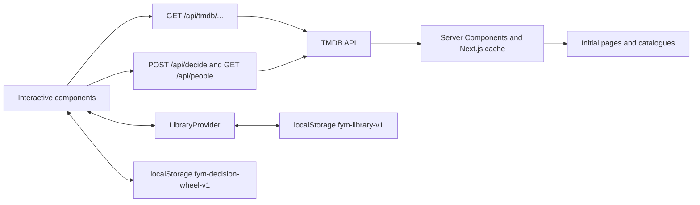

# FyM — Architecture

**English** · [Español](../es/ARCHITECTURE.md) · [Documentation](README.md)

## Scope and data flow

FyM explores an external film and series catalogue, provides detail pages and stores a personal library and roulette locally. It does not provide playback, accounts, payments or cloud synchronization.



`src/lib/api/client.ts` defines typed catalogue operations. Browser requests use local routes. `src/lib/api/server.ts` is protected by `server-only` and instantiates the authenticated client. Use `TMDB_API_KEY`; the legacy public-prefixed variable is accepted only by server modules for compatibility.

The catalogue proxy allowlists public read endpoints, rejects arbitrary destinations and does not forward browser-supplied keys. It has timeouts, normalizes upstream errors and preserves 404 responses. Successful catalogue responses are cached for one hour, so provider availability can change within the cache interval.

## Routes and responsibilities

| Route                         | Responsibility                                                      |
| ----------------------------- | ------------------------------------------------------------------- |
| `/`                           | Featured selection, trends, series and decision-tool entry          |
| `/decide`                     | Preferences, random suggestions, title search and personal roulette |
| `/movies`, `/series`          | Categories, remote filters and explicit pagination                  |
| `/search`                     | Debounced search, content types and additional results              |
| `/watchlist`                  | Pending/watched items, local search and sorting                     |
| `/movie/[id]`, `/series/[id]` | Details, videos, cast, crew and providers by country                |
| `/collection/[id]`            | Collection films sorted by release or rating                        |

`Catalog` shares film and TV browsing logic. `MediaDetails` shares detail-page structure; `Seasons` manages seasons, episodes and related material. Posters, rows, loading states, navigation, dialogs and icons are reusable components.

## Consistency and concurrency

- Identity includes type and ID: `movie-42` and `tv-42` are distinct.
- Additional pages are deduplicated before appending results.
- Search and filters use request generations to discard late responses.
- Catalogue filters are serialized in URLs for direct navigation and sharing.
- Detail pages use `Promise.allSettled` so optional-provider or recommendation failures do not hide the main content.
- Season and episode views discard results after unmount or selection changes.

## Personal library

`fym-library-v1` stores `{ item, status, addedAt }` entries. Valid statuses are `pending` and `watched`. Writes are acknowledged only after `localStorage.setItem` succeeds. Storage events reflect library changes from other tabs. Storage failures show a message and preserve the previous state.

Clearing browser data removes the library. Concurrent writes in multiple tabs are not transactional. Future cloud synchronization would require authentication, a database and conflict resolution; those are outside the current product.

## Candidate selection API

`decision.ts` owns validation, public-field projection and wheel geometry. `decision-server.ts` uses `server-only` and the authenticated client. It fetches up to five discovery pages (100 results), deduplicates them, shuffles with Fisher–Yates and `crypto.randomInt`, and returns 6, 9 or 12 candidates. The selected priority determines the source pages; this is explicitly a bounded sample, not uniform sampling of all TMDB films. Future releases and films with fewer than 100 votes are excluded.

`POST /api/decide` accepts up to four genres, three cast members, years from 1870 to 2100, minimum rating, maximum runtime and an enumerated priority. It rejects inverted ranges, invalid types and oversized bodies (8 KiB content-length/8192-character text guard). Provider parameters are built from validated fields rather than forwarded objects. Genres support any/all matching; all selected cast members must appear.

`GET /api/people` accepts queries of 2–100 characters and returns up to eight acting matches with ID, name, image path and known titles. Both routes normalize failures without exposing private upstream messages and project only public fields. Neither the personal library nor the roulette list is sent upstream. Interactive film search uses the existing restricted catalogue proxy.

## Roulette and local state

`DecisionStudio` separates suggestions from selected candidates: regenerating suggestions does not replace the wheel. Users explicitly replace the selection, search titles or import pending library films. Requests use debouncing, cancellation and generations. Storage restoration validates records and tolerates malformed data. The wheel deduplicates films, caps at 12 and reports write failures. It does not synchronize between tabs or devices.

Each candidate has equal probability. `crypto.getRandomValues` with rejection sampling chooses an unbiased index before animation. `wheelRotation` puts the winning segment's centre under the pointer after five complete turns. Only `transform` animates, for 4.2 seconds. Candidate edits are disabled during a spin, unmount clears the timer and changing candidates invalidates the previous result. Reduced motion reveals the winner without spinning. This local selection is not a third-party-verifiable drawing.

## Accessibility and motion

The UI uses Spanish language metadata, a skip link, labelled fields, accessible names for icon controls, focus indicators and status messages. Native dialogs trap and restore focus. `prefers-reduced-motion` removes transitions, animations and smooth scrolling. Layouts are checked at desktop, tablet and mobile widths; this is not a full WCAG certification or cross-browser matrix.

## Validation and recorded evidence

```bash
npm run lint
npm test
npm run build
```

See [the setup guide](README.md#commands-and-checks) for opt-in API tests. Domain tests cover identity, metadata, deduplication, preferences, projection, storage, randomness and geometry. Browser work reports and captures reside in ignored `.taste-skill/` and `.impeccable/review/` directories, not the published application.

Recorded on October 28, 2026 in Chromium on Windows:

- Initial redesign: 5 domain tests and 26 browser checks passed, with no JavaScript exceptions. An independent reviewer requested mobile/tablet decision access and a stable library accessible name; both fixes were scored resolved.
- Decision expansion: 17 tests passed with live API checks enabled (14 domain tests and 3 integration tests). The latter are skipped without `FYM_TEST_URL`. Another 21 browser checks covered search, pending imports, persistence, limits, winner geometry, saving, invalid/empty states and reduced motion.
- Decision inspection at 1440, 768 and 390 px found no horizontal overflow or broken images. Final inspection had 0 failures and 2 warnings: unequal heights of independent task panels and secondary 12px metadata. The real title “Coyote vs. Acme” required a documented placeholder-detector exception. Independent final disposition: ship.
- A production scan of 21 public JavaScript files found no configured TMDB credential matches.
- The subsequent logo/footer/action update passed lint, production build and responsive checks at the same three widths.

These are historical observations, not continuously enforced guarantees.

## External dependencies and limits

Translations, images and availability depend on TMDB coverage. General search returns films and series; actor lookup belongs to preferences and has no person-detail page. Recommendations are not a personalized machine-learning model. YouTube trailers can depend on provider permissions. Browser-local persistence and sampling limitations are also summarized in the [guide](README.md#persistence-and-limitations).
