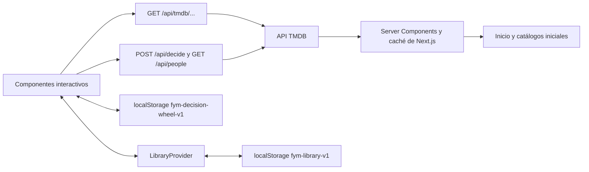

# Arquitectura de FyM

[English](../en/ARCHITECTURE.md) · **Español** · [Documentación](README.md)

## Alcance

FyM es una aplicación de descubrimiento de cine y series. Permite explorar un catálogo externo, evaluar una ficha y organizar una biblioteca personal en el navegador. No reproduce películas ni ofrece cuentas, pagos o sincronización entre dispositivos.

## Flujo de datos



`src/lib/api/client.ts` contiene los contratos tipados y las operaciones del catálogo. El navegador consulta únicamente la ruta local. `src/lib/api/server.ts`, protegido con `server-only`, instancia el cliente con credenciales para los componentes de servidor. La clave recomendada es `TMDB_API_KEY`; la variable antigua se acepta exclusivamente en módulos de servidor.

La ruta de consulta permite únicamente un conjunto explícito de endpoints públicos de lectura. No acepta destinos arbitrarios ni reenvía claves enviadas por el navegador. Tiene tiempo límite, normaliza fallos del proveedor y conserva el estado 404. Las respuestas correctas se almacenan en caché durante una hora. La disponibilidad puede cambiar dentro de ese intervalo.

## Superficies y responsabilidades

| Ruta                          | Responsabilidad                                                              |
| ----------------------------- | ---------------------------------------------------------------------------- |
| `/`                           | Selección destacada, tendencias, series y acceso a Elige por mí              |
| `/decide`                     | Preferencias, candidatas aleatorias, búsqueda de películas y ruleta personal |
| `/movies`, `/series`          | Catálogo, categorías, filtros remotos y paginación explícita                 |
| `/search`                     | Búsqueda con debounce, tipo de contenido y más resultados                    |
| `/watchlist`                  | Pendientes, vistas, búsqueda y orden local                                   |
| `/movie/[id]`, `/series/[id]` | Ficha, vídeos, reparto, equipo y proveedores por país                        |
| `/collection/[id]`            | Películas de una colección ordenadas por estreno o valoración                |

`Catalog` reutiliza el flujo de películas y series. `MediaDetails` comparte la estructura de las fichas; `Seasons` concentra temporada, episodios y material adicional. Los carteles, carruseles, estados de carga, navegación, diálogos e iconos tienen componentes comunes.

## Consistencia y concurrencia

- Las entidades se identifican por tipo e ID: `movie-42` y `tv-42` son diferentes.
- Las páginas adicionales se deduplican antes de incorporarse al catálogo.
- Búsqueda y filtros usan generaciones de solicitud para descartar respuestas anteriores que lleguen tarde.
- Los filtros se serializan en la URL y pueden abrirse o compartirse directamente.
- Una ficha utiliza `Promise.allSettled`: el fallo de una recomendación o proveedor no debe ocultar la información principal.
- Las vistas de temporada y episodio descartan resultados al desmontarse o cambiar su selección.

## Biblioteca personal

Se almacena un array de `{ item, status, addedAt }` bajo `fym-library-v1`. Los estados permitidos son `pending` y `watched`. Las operaciones de escritura se confirman al usuario solo después de completar `localStorage.setItem`. El evento `storage` permite reflejar cambios hechos en otras pestañas. Un fallo de permisos o almacenamiento muestra un mensaje y conserva el estado previo.

Es persistencia local: borrar los datos del navegador elimina la biblioteca. No hay garantía transaccional entre escrituras simultáneas de varias pestañas. Una futura sincronización requeriría autenticación, base de datos y resolución de conflictos; esos componentes no forman parte de esta entrega.

## Accesibilidad y movimiento

Idioma español, enlace para saltar al contenido, campos con etiquetas, nombres accesibles en controles de icono, indicadores de foco y mensajes de estado. Los diálogos nativos mantienen el foco dentro de la ventana y lo restauran al cerrar. El movimiento responde al cambio de selección y a acciones del usuario; `prefers-reduced-motion` elimina desplazamientos y transiciones.

## Selección y ruleta

`decision.ts` concentra validación, proyección de datos públicos y geometría. `decision-server.ts` usa `server-only` y el cliente autenticado: consulta hasta cinco páginas de descubrimiento (100 resultados), deduplica, mezcla mediante Fisher–Yates y `crypto.randomInt`, y devuelve 6, 9 o 12 candidatas. La prioridad elegida determina las páginas de origen; el muestreo no es uniforme sobre todo TMDB y se declara en la interfaz. Se excluyen fechas futuras y títulos con menos de 100 votos.

`POST /api/decide` admite hasta cuatro géneros, tres personas del reparto, años entre 1870 y 2100, valoración mínima, duración máxima y una prioridad enumerada. El servidor rechaza rangos invertidos, tipos inválidos y cuerpos extensos (límite declarado de 8 KiB y comprobación adicional de 8192 caracteres). Construye los parámetros desde campos validados; nunca reenvía objetos arbitrarios. Los géneros admiten coincidencia con cualquiera o todos; todas las personas seleccionadas deben aparecer en el reparto. `GET /api/people` busca intérpretes con consultas de 2 a 100 caracteres y devuelve hasta ocho coincidencias con ID, nombre, imagen y títulos conocidos. Ambas rutas normalizan fallos sin publicar mensajes privados del proveedor; solo devuelven campos públicos. La lista personal y la ruleta no se envían al proveedor.

`DecisionStudio` separa las candidatas propuestas de las seleccionadas: regenerar el catálogo no sobrescribe la ruleta. Puede buscar películas, importar pendientes de la biblioteca o reemplazar explícitamente la selección. Las solicitudes usan debounce, cancelación y generaciones para descartar respuestas tardías. Los títulos se deduplican y la ruleta se limita a 12. Al restaurar `fym-decision-wheel-v1`, se validan los datos y se tolera almacenamiento dañado. Las escrituras fallidas se comunican; no hay sincronización de la ruleta entre pestañas ni dispositivos.

Cada candidata tiene igual probabilidad en el giro: `crypto.getRandomValues` con muestreo por rechazo obtiene un índice sin sesgo modular. El índice se elige antes de animar; `wheelRotation` sitúa el centro del sector correspondiente bajo la aguja después de cinco vueltas. La transición solo modifica `transform` durante 4,2 segundos. Se bloquea la edición durante el giro, se limpia el temporizador al desmontar y cambiar la composición invalida el resultado anterior. Con movimiento reducido se muestra la ganadora sin giro. La elección es local y no constituye un sorteo verificable por terceros.

## Validación

```powershell
npm run lint
npm test
npm run build
```

Las pruebas automatizadas de dominio cubren colisiones entre tipos, inferencia de series, deduplicación de páginas y metadatos incompletos. La verificación de navegador de esta entrega cubre guardado persistente, vistas, filtros combinados, búsqueda, fichas, carteles, tráileres, selección de país, temporadas, episodios, colecciones y estados de error. Los informes y capturas de trabajo se guardan en `.taste-skill/` y `.impeccable/review/`, sin formar parte de la aplicación publicada.

## Límites y decisiones

La aplicación depende de TMDB y de su cobertura de traducciones, imágenes y proveedores. Las valoraciones y fechas se presentan como datos del catálogo; no se inventan. La selección por preferencias no usa un modelo de recomendación personal. La búsqueda general devuelve películas y series; la búsqueda de reparto pertenece al selector de preferencias y no enlaza a una ficha de persona. Los tráileres se reproducen mediante YouTube y pueden depender de permisos del proveedor.

## Evidencia de esta entrega

Verificación del 28 de octubre de 2026 en Chromium sobre Windows: lint sin errores; 5 pruebas de dominio aprobadas; compilación de producción correcta; 26 comprobaciones de navegador aprobadas, sin excepciones JavaScript. Inicio y ficha se inspeccionaron a 1440, 768 y 390 px con 0 fallos. Permanecen advertencias por metadatos compactos y por bloques de ficha situados debajo del primer viewport. No se ha realizado una certificación completa WCAG ni una matriz de navegadores.

La revisión independiente identificó dos ajustes: conservar la selección aleatoria en móvil/tablet y mantener el nombre accesible del enlace de biblioteca. Ambos fueron corregidos y evaluados como resueltos en el veredicto final. Diseño y sidecar se actualizaron tras ese lote.

La ampliación «Elige por mí» añade 9 pruebas de dominio y 3 de API: 17 pruebas en total aprobadas al ejecutar con `FYM_TEST_URL`, incluidas consultas reales con reparto, género, año y duración. Las 3 pruebas de integración se omiten si esa variable no está definida. Se verificaron 21 comprobaciones adicionales en Chromium: importación, búsqueda propia, persistencia, límite de candidatas, correspondencia entre sector y ganadora, guardado, errores, estados vacíos y movimiento reducido. A 1440, 768 y 390 px no se encontró desbordamiento horizontal ni imágenes rotas. El inspector final registra 0 fallos y dos advertencias: altura desigual de paneles con tareas diferentes y metadatos secundarios de 12 px. Se permitió únicamente el detector de datos de muestra porque el título real «Coyote vs. Acme» produjo un falso positivo. Las capturas y el informe permiten revisar esa decisión. El análisis de los 21 archivos JavaScript públicos de la compilación no encontró ninguna coincidencia con las credenciales configuradas de TMDB.

La actualización posterior de logo, pie y acceso destacado pasó lint, compilación de producción y comprobaciones adaptables a 1440, 768 y 390 px. La evidencia anterior es histórica y no sustituye ejecutar las comprobaciones tras cada cambio.
